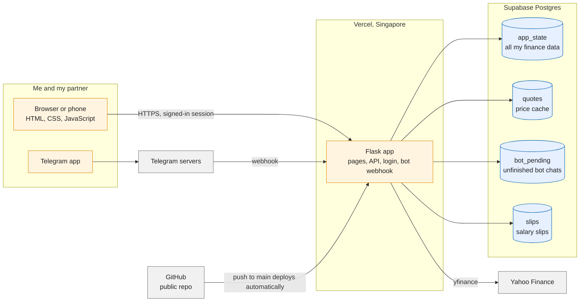
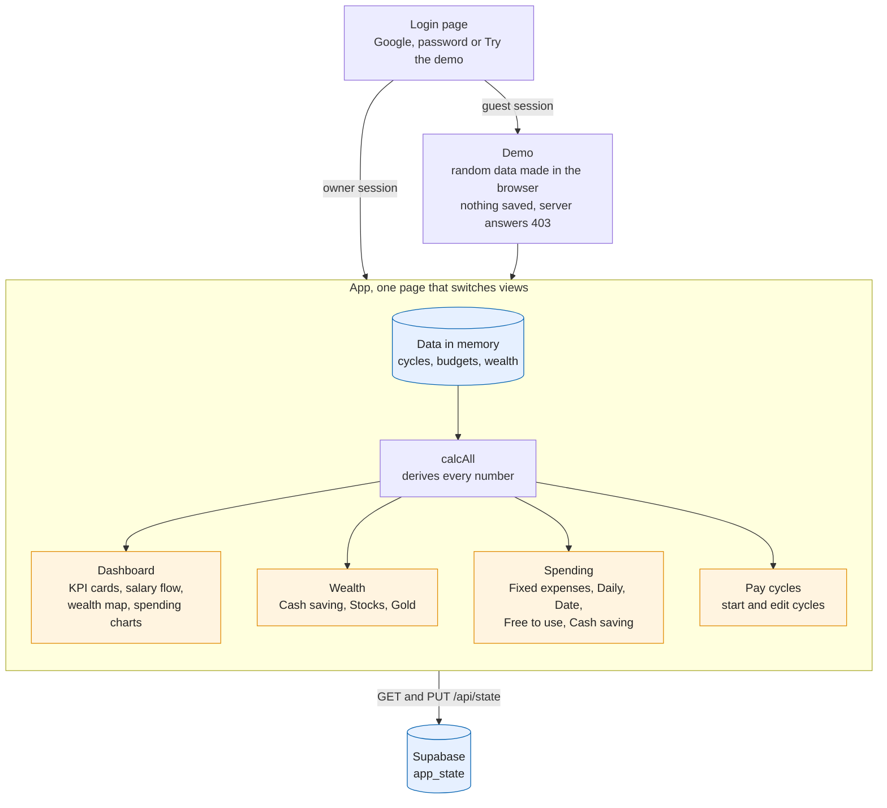
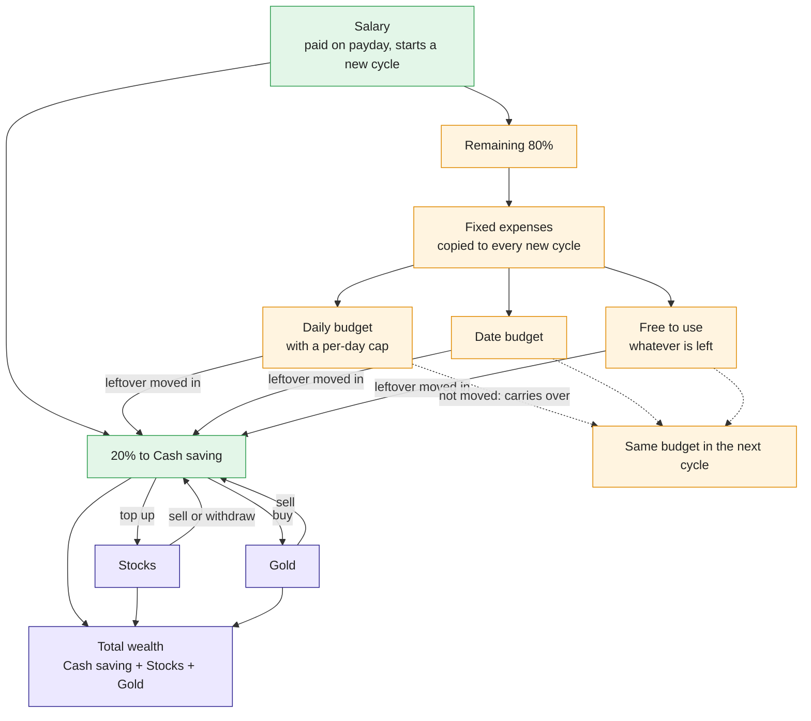
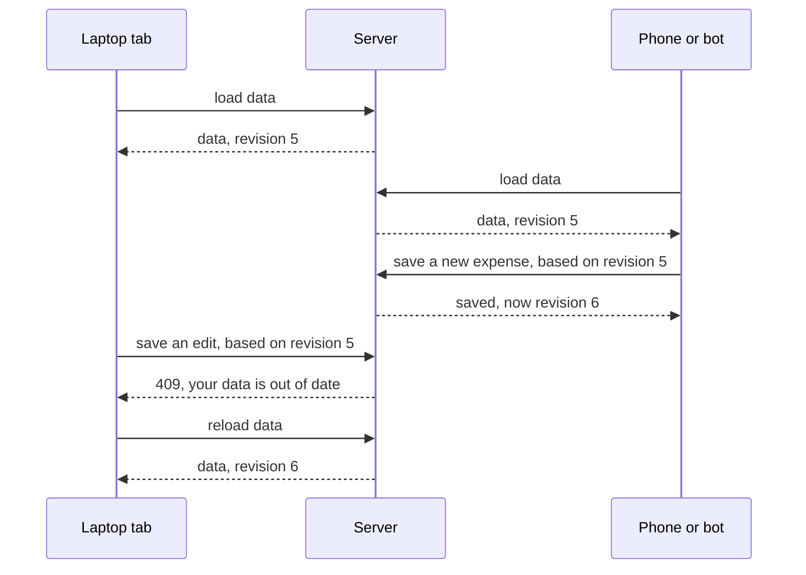
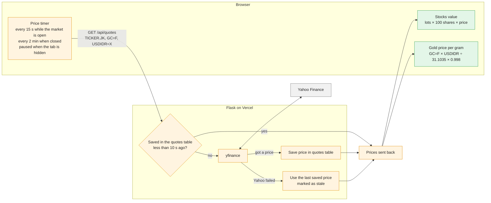
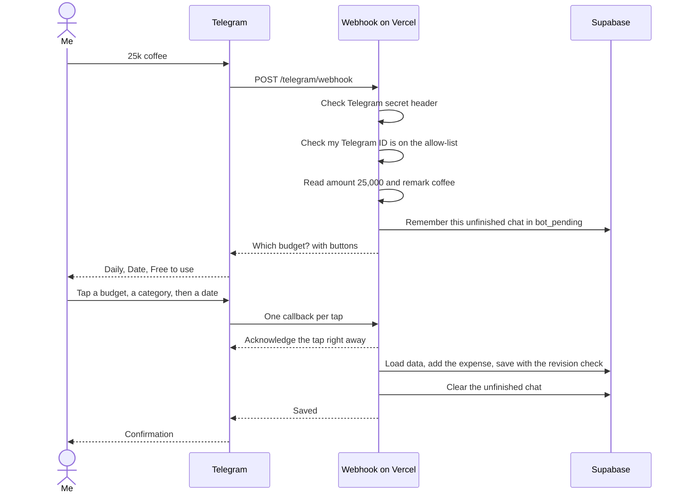
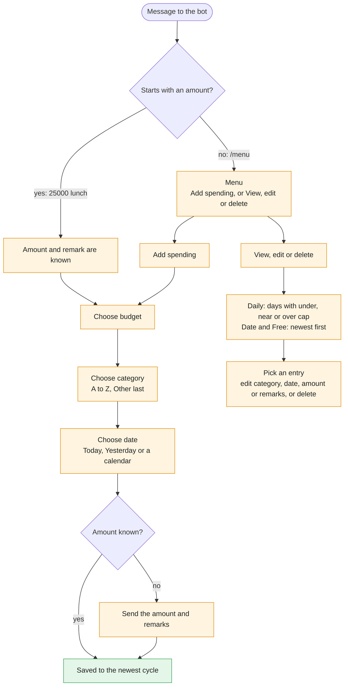

# Darren's Finance

A personal finance tracker that I built for myself, and for my partner, to see where our money goes each month and how our wealth is growing.

**Live site:** https://darrens-finance.vercel.app (the real data is private, but you can click **Try the demo** on the login page to explore it with random data)

## Why I built it

Spreadsheets and bank apps never matched how I actually think about money. I get paid once a month, on a date that moves around the last week of the month, and I split every salary the same way:

- **20%** goes straight into a cash saving.
- The rest pays my **fixed expenses**, then funds three budgets: **daily**, **date** and **free to use**.
- Whatever is left in a budget can be moved into cash saving, or carried over to the next month.
- New money for investing (stocks and gold) is taken from cash saving, so my wealth is always honest.

So I made a small website that follows exactly those rules.

## What it does

- **Dashboard:** a flow diagram that shows how one salary branches into savings, fixed expenses and budgets, and what is left in each, plus spending charts (a donut by category and a daily trend).
- **Wealth:** cash saving, stocks (Stockbit) and gold (Treasury) in one place, with live prices, profit or loss, and buying and selling that moves money to and from cash saving.
- **Spending:** every expense by budget, with a daily cap that turns each day green or red.
- **Pay cycles:** start a new cycle every payday. Past cycles stay saved and can be opened any time.
- **Privacy eye:** one button that hides every number on screen, like in a banking app.
- **Telegram bot:** I can add, view, edit and delete spending from my phone without opening the site (see below).
- **Works on phones, tablets and laptops.**
- **Guest demo:** a visitor gets randomly generated data and simulated prices. Nothing is saved, and the server refuses to hand guests any real data.

## The big picture

Everything runs on free tiers. GitHub holds the code, Vercel runs it, and Supabase stores the data. Every push to `main` deploys by itself.



The same code also runs on my laptop. Without `DATABASE_URL` it keeps everything in local JSON files, needs no login, and works as a sandbox.

## Inside the website

After signing in (Google, a password, or the demo), there are four pages. They all read one in-memory copy of the data and calculate every number from it, so a number can never differ between two pages.



### The money rules the site follows

This is the whole idea behind the app: one salary, split the same way every month.



### Saving without overwriting myself

Each browser tab holds the whole data and saves all of it, so two open devices could overwrite each other. A revision number (`_rev`) prevents that. The server refuses a save from a tab that is behind, and that tab reloads. The Telegram bot follows the same rule.



## Live prices from Yahoo Finance

Stocks and gold are tracked live with no paid data source. Stockbit has no public API, so I type in my lots once, and the site prices them with Yahoo Finance. Treasury (gold) has no Yahoo price for Indonesia either, so the site works out the price per gram from the world gold price and the dollar exchange rate.



- **Stocks:** Indonesian stocks use the `.JK` ending on Yahoo. Prices are delayed by about 10 minutes, and the site only polls quickly during trading hours (Monday to Friday, 09:00 to 16:00 Jakarta time).
- **Gold:** `GC=F` is gold futures in US dollars per troy ounce. One troy ounce is 31.1035 grams. I multiply by `USDIDR=X` to get rupiah per gram, then by 0.998, a factor I calibrated against what the Treasury app actually showed, because it matched within 0.03%.
- **Cache:** the `quotes` table means many page loads share one Yahoo request, which keeps the site fast and polite to Yahoo.
- **Fallback:** if Yahoo is down or blocks the request, the last saved price is shown and marked as stale instead of an error.
- **Demo:** guests get simulated prices made in the browser, and never call Yahoo.

## Telegram bot

Opening a website every time I buy a coffee is too much effort, so I added a private Telegram bot. It works on the **daily, date and free spending** budgets, and it uses the same data and rules as the site.

- **Quick add:** send a message that starts with the amount, such as `25000 lunch`, `25k coffee` or `1.5jt rent`. The bot then asks for the budget, the category and the date with buttons. The `k`, `rb` and `jt` suffixes mean thousand, thousand and million.
- **Guided add:** `/menu` shows **Add spending** and **View, edit or delete**.
- **View, edit and delete:** the daily budget is listed day by day with its total and whether it is under, near or over the daily cap. The date and free budgets are listed newest first. Delete always asks first.
- **Private:** only the Telegram IDs on my allow-list get an answer, and Telegram's webhook secret is checked on every request.
- **Shared categories:** the website and the bot read the same list, `static/categories.json`.

Here is what happens when I send `25k coffee`:



Anyone who is not on the allow-list only gets "This bot is private" and their own Telegram ID, so I can add my partner later.

There are two ways to add spending, and both end in the same place:



The bot runs as a webhook on the same Vercel deployment (`/telegram/webhook`, code in `telegram_bot.py`). It shares the data, the rules and the category list with the website, and Vercel runs in Singapore, next to the database, to keep every tap fast. To try it locally without a webhook, run `tools/telegram_poll.py`.

## How it is built

| Part | Choice |
|---|---|
| Backend | Python and Flask |
| Frontend | Plain HTML, CSS and JavaScript (no framework, no build step) |
| Design | A "liquid glass" look with bank brand colors and Fluent UI System Icons |
| Prices | Yahoo Finance through `yfinance` (stocks, gold futures and USD/IDR) |
| Database | Supabase Postgres on the live site, a local JSON file when running on my laptop |
| Login | Google sign-in with an allow-list, plus a password as a backup |
| Bot | Telegram Bot API through a webhook |
| Hosting | Vercel (every push to `main` deploys automatically) |
| Python tooling | [uv](https://docs.astral.sh/uv/) |

The same code runs both locally and on the web. If `DATABASE_URL` is set, it uses the database. If not, it keeps everything in `data/` and needs no login.

## Run it yourself

You need Python 3.14 and [uv](https://docs.astral.sh/uv/).

```powershell
uv run python app.py
```

Then open http://127.0.0.1:5000. On a fresh clone the app starts with an empty cycle, so you can enter your own salary and budgets.

To use the login and the database, set these environment variables (a local `.env` file works):

| Variable | Purpose |
|---|---|
| `DATABASE_URL` | Postgres connection string (use a pooler URL on Vercel) |
| `SITE_PASSWORD` | Password sign-in |
| `SECRET_KEY` | Signs the session cookie |
| `GOOGLE_CLIENT_ID`, `GOOGLE_CLIENT_SECRET` | Google sign-in |
| `ALLOWED_EMAILS` | Comma-separated emails allowed to sign in with Google |
| `TELEGRAM_BOT_TOKEN` | Token from BotFather (only if you want the bot) |
| `TELEGRAM_ALLOWED_IDS` | Comma-separated Telegram IDs allowed to use the bot |
| `GUEST_DEMO=0` | Optional. Turns the demo off |

## Project layout

```
app.py              Flask app: pages, API, login, price cache, bot webhook
telegram_bot.py     The Telegram bot
templates/          Login page and the app shell
static/js/app.js    All app logic and views
static/js/demo.js   Random demo data and simulated prices
static/css/         The whole theme, including every responsive rule
static/categories.json  The category list shared by the site and the bot
tools/              Helper scripts (icon builder, database import, backup, local bot polling)
```

## A note on privacy

This repository is public, so it contains **no personal or financial data and no credentials**. My real data lives only in the private database, and secrets live only in environment variables.

## License

The code is released under the [MIT License](LICENSE). The license covers my code only. The logos and icons keep their own licenses, listed below.

## Credits

- Icons: [Fluent UI System Icons](https://github.com/microsoft/fluentui-system-icons) by Microsoft (MIT license, see `static/icons/`).
- Charts use [Chart.js](https://www.chartjs.org/) (MIT license), included in `static/vendor/`.
- Bank and wallet logos for BCA, Jago and GoPay come from [hafidznoor/idn-finlogos](https://github.com/hafidznoor/idn-finlogos) (CC BY-NC 4.0, personal use). The Stockbit and Treasury logos belong to their owners. All brand names and logos are trademarks of their respective companies, and I am not affiliated with any of them.
- Font: [Nunito](https://fonts.google.com/specimen/Nunito) from Google Fonts.

This is a personal project and not financial advice. Prices from Yahoo Finance are unofficial and delayed.
